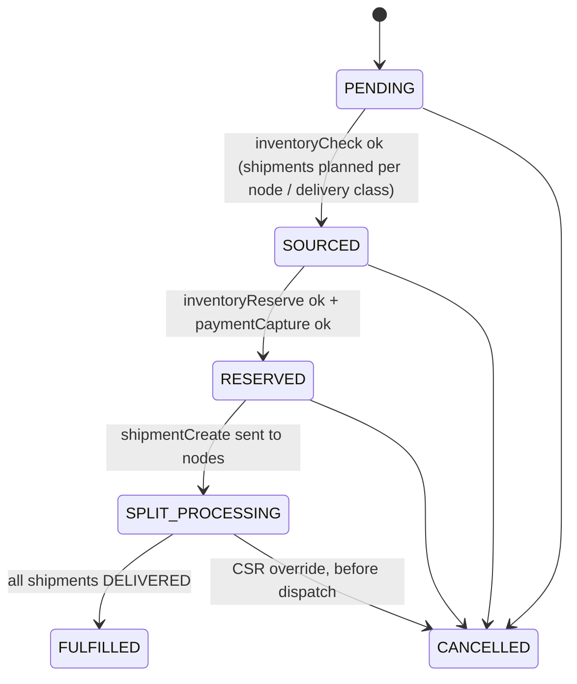

# OMS Service (Order Management System)

Java 21 / Spring Boot 3.3, PostgreSQL 16, Redis 7, Kafka (KRaft). Single default profile; runs as a ClusterIP service on Docker Desktop Kubernetes.

## Run locally (Docker Desktop, Kubernetes enabled)
```bash
docker build -t oms-service:1.0.0 .
kubectl apply -f k8s/          # namespace, postgres, redis, kafka, oms-service
kubectl -n oms get pods -w
kubectl -n oms port-forward svc/oms-service 8080:8080
./scripts/kafka-commands.sh list-topics
```
Topics are also created automatically on startup (`KafkaConfig`); the script is for manual/ops use.

## Order state machine

Shipment: PLANNED -> DISPATCH_REQUESTED -> PACKED -> DISPATCHED -> DELIVERED (CANCELLED).
RMA: REQUESTED -> APPROVED -> PICKUP_SCHEDULED -> QC_INSPECTION -> REFUNDED | EXCHANGED (REJECTED).

## Saga (orchestrated, `SagaOrchestrator`)
| Step | Command (outbox) | Success event | Failure => compensation |
|---|---|---|---|
| INVENTORY_CHECK | oms.wms.inventoryCheck | wms.oms.inventoryCheckResult | stock-out => exclude node, re-source (max 3) else cancel |
| INVENTORY_RESERVE | oms.wms.inventoryReserve | wms.oms.inventoryReserveResult | cancel |
| PAYMENT_CAPTURE | oms.payment.paymentCapture | payment.oms.paymentCaptureResult | InventoryReleaseCommand, cancel |
| SHIPMENT_DISPATCH | oms.logistics.shipmentCreate | logistics.oms.shipmentCreateResult / shipmentStatus | ShipmentCancel, PaymentRefund, InventoryRelease |

Late success after a cancellation (race) triggers an immediate release/refund. A CSR hold pauses outgoing commands; release re-emits the paused step.

## Kafka
* Names: `sourceSystem.destinationSystem.purpose`, centralised in `KafkaTopics` / `KafkaGroups`.
* Envelope `EventEnvelope{eventId,eventType,tenantId,aggregateType,aggregateId,correlationId,occurredAt,schemaVersion,payload}`; payload contracts in `Events`. Key = orderId/rmaId.
* Package `com.oms.kafka`: `consumer/` (OMS inbound, de-duplicated via `processed_messages`), `stub/DownstreamSimulator` (answers every command topic with a success event; disable with `oms.stub.enabled=false`).
* Error handling: 1 retry (1s) then row in `failed_events`; outbox rows get 2 attempts then also parked. Re-drive: `GET /api/v1/admin/failed-events`, `POST .../{id}/retry`, `POST .../retry-all`.
* Consumer groups can't be pre-created in Kafka (they appear on first join); the script offers describe/lag/reset.

## Schema
`src/main/resources/db/migration/V1__oms_schema.sql`: orders, order_items, shipments, shipment_items, order_saga, outbox_events, failed_events, processed_messages, audit_logs (append-only trigger), rmas, rma_items.

## API quick tour

Use the commands below in order. Each step builds on the previous response and follows a realistic order lifecycle from creation to fulfillment.

### 1) Create an order
```bash
curl -sS -X POST http://localhost:8080/api/v1/orders \
  -H 'Content-Type: application/json' \
  -H 'X-Actor-Type: CUSTOMER' \
  -H 'X-Actor-Id: c1' \
  -d '{
    "tenantId": "t1",
    "parentOrgId": "p1",
    "subOrgId": "s1",
    "customerId": "c1",
    "channel": "B2C_STOREFRONT",
    "cartToken": "cart-001",
    "externalOrderRef": "ext-1001",
    "currency": "INR",
    "regionCode": "BLR",
    "deliveryFee": 20,
    "walletAmount": 0,
    "priority": "NORMAL",
    "shippingAddress": {
      "name": "Asha Verma",
      "line1": "1 MG Road",
      "city": "Bengaluru",
      "state": "Karnataka",
      "postalCode": "560001",
      "country": "IN"
    },
    "items": [
      {
        "sku": "MILK-1",
        "productName": "Fresh Milk 1L",
        "category": "FRESH_FOOD",
        "hsnCode": "0401",
        "quantity": 2,
        "unitPrice": 50,
        "discountAmount": 0,
        "taxType": "CGST_SGST",
        "taxRate": 5
      },
      {
        "sku": "TV-1",
        "productName": "Smart TV 43 inch",
        "category": "ELECTRONICS",
        "hsnCode": "8528",
        "quantity": 1,
        "unitPrice": 20000,
        "discountAmount": 0,
        "taxType": "IGST",
        "taxRate": 18
      }
    ]
  }'
```

Save the returned `id` into `ORDER_ID`.
```bash
export ORDER_ID="<id-from-create-response>"
```

### 2) Get order details
```bash
curl -sS "http://localhost:8080/api/v1/orders/${ORDER_ID}"
```

### 3) List orders for a tenant/customer
```bash
curl -sS "http://localhost:8080/api/v1/orders?tenantId=t1&customerId=c1&page=0&size=20"
```

### 4) View the order timeline
```bash
curl -sS "http://localhost:8080/api/v1/orders/${ORDER_ID}/timeline"
```

### 5) Update delivery details
```bash
curl -sS -X PATCH "http://localhost:8080/api/v1/orders/${ORDER_ID}/delivery" \
  -H 'Content-Type: application/json' \
  -H 'X-Actor-Type: CUSTOMER' \
  -H 'X-Actor-Id: c1' \
  -d '{
    "shippingAddress": {
      "name": "Asha Verma",
      "line1": "12 Residency Road",
      "city": "Bengaluru",
      "state": "Karnataka",
      "postalCode": "560025",
      "country": "IN"
    },
    "deliverySlotStart": "2026-11-06T10:00:00Z",
    "deliverySlotEnd": "2026-11-06T12:00:00Z",
    "reason": "Updated delivery location"
  }'
```

### 6) Amend order items before warehouse release
```bash
export ORDER_ITEM_ID="<first-order-item-id-from-order-response>"

curl -sS -X PATCH "http://localhost:8080/api/v1/orders/${ORDER_ID}/items" \
  -H 'Content-Type: application/json' \
  -H 'X-Actor-Type: CUSTOMER' \
  -H 'X-Actor-Id: c1' \
  -d '{
    "reason": "Increase milk quantity",
    "changes": [
      {
        "orderItemId": "'"${ORDER_ITEM_ID}"'",
        "newQuantity": 3
      }
    ]
  }'
```

### 7) Cancel an order (if needed)
```bash
curl -sS -X POST "http://localhost:8080/api/v1/orders/${ORDER_ID}/cancel" \
  -H 'Content-Type: application/json' \
  -H 'X-Actor-Type: CSR' \
  -H 'X-Actor-Id: csr-7' \
  -d '{
    "reason": "Customer requested cancellation before dispatch"
  }'
```

### 8) Create an RMA for a delivered order
```bash
curl -sS -X POST "http://localhost:8080/api/v1/orders/${ORDER_ID}/rmas" \
  -H 'Content-Type: application/json' \
  -H 'X-Actor-Type: CUSTOMER' \
  -H 'X-Actor-Id: c1' \
  -d '{
    "type": "RETURN",
    "reason": "Damaged product",
    "items": [
      {
        "orderItemId": "'"${ORDER_ITEM_ID}"'",
        "quantity": 1,
        "replacementSku": "MILK-2"
      }
    ]
  }'
```

Save the returned RMA id into `RMA_ID`.
```bash
export RMA_ID="<id-from-rma-response>"
```

### 9) List RMAs for an order
```bash
curl -sS "http://localhost:8080/api/v1/orders/${ORDER_ID}/rmas"
```

### 10) CSR order and RMA operations
Hold an order:
```bash
curl -sS -X POST "http://localhost:8080/api/v1/csr/orders/${ORDER_ID}/hold" \
  -H 'Content-Type: application/json' \
  -H 'X-Actor-Type: CSR' \
  -H 'X-Actor-Id: csr-7' \
  -d '{
    "reason": "Payment verification in progress"
  }'
```

Release hold:
```bash
curl -sS -X POST "http://localhost:8080/api/v1/csr/orders/${ORDER_ID}/release-hold" \
  -H 'X-Actor-Type: CSR' \
  -H 'X-Actor-Id: csr-7'
```

Update priority:
```bash
curl -sS -X POST "http://localhost:8080/api/v1/csr/orders/${ORDER_ID}/priority" \
  -H 'Content-Type: application/json' \
  -H 'X-Actor-Type: CSR' \
  -H 'X-Actor-Id: csr-7' \
  -d '{
    "priority": "HIGH"
  }'
```

Reconcile payment:
```bash
curl -sS -X POST "http://localhost:8080/api/v1/csr/orders/${ORDER_ID}/reconcile-payment" \
  -H 'X-Actor-Type: CSR' \
  -H 'X-Actor-Id: csr-7'
```

Get a specific RMA:
```bash
curl -sS "http://localhost:8080/api/v1/csr/rmas/${RMA_ID}"
```

Approve RMA:
```bash
curl -sS -X POST "http://localhost:8080/api/v1/csr/rmas/${RMA_ID}/approve" \
  -H 'X-Actor-Type: CSR' \
  -H 'X-Actor-Id: csr-7'
```

Reject RMA:
```bash
curl -sS -X POST "http://localhost:8080/api/v1/csr/rmas/${RMA_ID}/reject" \
  -H 'Content-Type: application/json' \
  -H 'X-Actor-Type: CSR' \
  -H 'X-Actor-Id: csr-7' \
  -d '{
    "reason": "Return claim not valid"
  }'
```

Retry refund:
```bash
curl -sS -X POST "http://localhost:8080/api/v1/csr/rmas/${RMA_ID}/retry-refund" \
  -H 'X-Actor-Type: CSR' \
  -H 'X-Actor-Id: csr-7'
```

### 11) Failed-event admin and metrics endpoints
List failed events:
```bash
curl -sS "http://localhost:8080/api/v1/admin/failed-events"
```

Retry one failed event:
```bash
export FAILED_EVENT_ID="<id-from-failed-events-response>"
curl -sS -X POST "http://localhost:8080/api/v1/admin/failed-events/${FAILED_EVENT_ID}/retry"
```

Retry all failed events:
```bash
curl -sS -X POST "http://localhost:8080/api/v1/admin/failed-events/retry-all"
```

SLA metrics:
```bash
curl -sS "http://localhost:8080/api/v1/metrics/sla?tenantId=t1"
```

### Minimal happy-path summary
If you want the shortest path to a fulfilled order, run these commands in order:
```bash
curl -sS -X POST http://localhost:8080/api/v1/orders ...
curl -sS http://localhost:8080/api/v1/orders/${ORDER_ID}
curl -sS "http://localhost:8080/api/v1/orders?tenantId=t1&customerId=c1&page=0&size=20"
curl -sS "http://localhost:8080/api/v1/orders/${ORDER_ID}/timeline"
curl -sS -X PATCH "http://localhost:8080/api/v1/orders/${ORDER_ID}/delivery" ...
curl -sS -X PATCH "http://localhost:8080/api/v1/orders/${ORDER_ID}/items" ...
curl -sS "http://localhost:8080/api/v1/metrics/sla?tenantId=t1"
```

The order flow is intentionally sequential: create order, inspect it, amend it if needed, then let the state machine and downstream adapters progress it to `SOURCED`, `RESERVED`, `SPLIT_PROCESSING`, and eventually `FULFILLED`.

All endpoints expect the gateway to provide authentication and actor identity via `X-Actor-Type` and `X-Actor-Id`; CSR-only endpoints reject non-CSR actors.
"# oms-service" 
